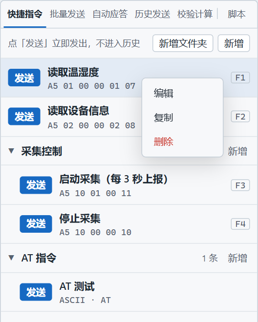
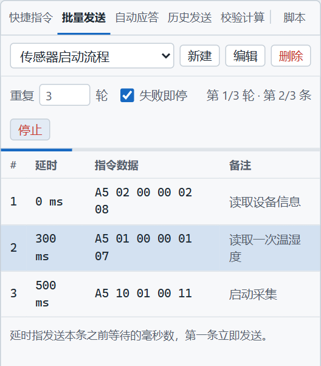

# 快捷指令与批量发送

> 摘要：快捷指令用来手发一条常用帧，可绑 F1–F8。批量发送把一组 HEX 按延时和轮数自动跑完。两者都不套用发送框的附加位，也不进历史。

一条读温湿度的指令，一天要点几十次，不值得每次在发送框里重打。设备上电后要先读信息、等一会儿、再读一次数据、再启动采集，也不值得对着发送框一步步掐表。这两件事分成两个页签：要人点一下才发的，放快捷指令；按顺序自己跑完的，放批量发送。

---

## 快捷指令：点一下，或按一个功能键

右侧「快捷指令」。顶部写着「点「发送」立即发出，不进入历史」。

上图是一组已经配好的指令：

| 名称 | 快捷键 | 数据 |
|------|--------|------|
| 读取温湿度 | F1 | `A5 01 00 00 01 07` |
| 读取设备信息 | F2 | `A5 02 00 00 02 08` |
| 启动采集（每 3 秒上报） | F3 | `A5 10 01 00 11` |
| 停止采集 | F4 | `A5 10 00 00 10` |
| AT 测试 | 无 | ASCII 的 `AT` |

点该行「发送」，或按绑定的 F1–F8。串口必须已经打开，否则提示「串口未打开，发送已拦截」。

几个硬约定：

- **一个功能键全局只属于一条指令。** 复制会立刻在旁边生成一条「副本」，副本不占用原来的功能键。
- **文件夹只有一层。** 根目录可以混放指令和文件夹，文件夹里只能放指令。点文件夹行展开或收起。编辑指令时可以改所属文件夹，移动后排到目标文件夹末尾。
- 行上只留「发送」。编辑、复制、删除在右键菜单里。删除文件夹会连同里面的指令一起删，确认框里写着条数。
- 指令数据是 HEX 或 ASCII。HEX 必须成对。ASCII 指令仍看左栏的「自动解析转义符」和「AT 指令自动回车」：上图的「AT 测试」在 AT 自动回车开着时，发出去的是 `41 54 0D 0A`。
- **不套用**发送框的附加位和「末尾追加回车换行」。`A5 01 00 00 01 07` 里的 `07` 若是校验，要自己写在指令数据里。
- 这些发送**不进历史**。

---

## 批量发送：一组帧按间隔跑完

右侧「批量发送」。适合上电初始化、一组寄存器挨个读、同一流程重复几轮。

上图的任务叫「传感器启动流程」，重复 3 轮，勾了「失败即停」，正跑在第 1 轮的第 2 条：

| # | 延时 | 指令数据 | 备注 |
|---|------|----------|------|
| 1 | 0 ms | `A5 02 00 00 02 08` | 读取设备信息 |
| 2 | 300 ms | `A5 01 00 00 01 07` | 读取一次温湿度 |
| 3 | 500 ms | `A5 10 01 00 11` | 启动采集 |

延时是「发这一条之前等多少毫秒」，从上一条发出之后算。整个任务的第一包不等待，这一步即使填了延时也会马上发。从第二步起，以及后面每一轮的第一步，都按该步填写的毫秒数等待。

点「开始发送」之后：

- 运行中高亮当前步。顶部显示「第几轮 · 第几条」，状态栏同步进度。
- 数据日志写系统行，例如「批量任务「传感器启动流程」开始，共 3 步 × 3 轮」，全部走完写「完成」。
- 点「停止」或按 Esc 结束，日志记「批量任务已手动停止」。对话框开着时，Esc 先关对话框。
- **失败即停**勾上后，某一步没写进串口，或某条 `before_send` 运行出错，任务停住，日志写「第 n 步失败，任务停止」。脚本返回 `nil` 把这一帧拦住时，日志记拦截，这一步算处理完，任务继续往下走。
- 不勾「失败即停」时，写失败的那一步跳过，后面的步骤继续。

批量和快捷指令一样：步骤按 HEX 原样发出，不套发送框的附加位和末尾回车，不进历史。上表每一帧的最后一个字节已经写在数据里。若希望所有步骤在发送前统一补 CRC，用《Lua 脚本教程》里的 `before_send`，不要指望左栏那个附加位开关。

串口关着时点开始，会提示「串口未打开，批量任务未启动」。

新建或编辑在对话框里完成。任务要有名称，至少一条指令；每条数据是成对 HEX，延时是非负毫秒。校验失败留在对话框里，不关闭。

---

## 和发送框怎么分工

同一组字节可以出现在三个地方，用途不同：

- **发送框**：正在试的一帧。看实发预览，确认附加位和回车。试通了再存起来。
- **快捷指令**：试通之后每天要手发的那几条。给最常用的绑上 F1–F8。
- **批量发送**：有先后、有等待的一整段流程。单条读数不要放进批量，免得为了一帧去点「开始发送」。

上图就是这个分法。F1、F2 是随手读一次；「传感器启动流程」把读信息和启动采集按 300 毫秒、500 毫秒串起来，并重复 3 轮。流程里的数据和快捷指令可以相同，改一处不会自动改另一处，存的是各自的一份副本。

---

## 用起来

1. 在发送框把一帧调到和手册一致（含校验），确认设备有反应。
2. 右侧「快捷指令」点「新增」，名称、HEX、数据填上，需要时指定 F1–F8 和文件夹。
3. 上电要连续做的几步，点「批量发送」的「新建」。第一步延时可以填 0。给每步写备注，跑的时候才知道高亮的是哪一条。
4. 打开串口。单条按功能键；整段流程点「开始发送」，看日志里的开始、每条 `SEND` 和完成。
5. 某一步必须带校验时，把校验字节写进该步的 HEX，或先加好 `before_send` 再跑批量。

快捷指令解决「这一条我还要再发一次」。批量发送解决「这几条要按这个间隔、按这个轮数自己走完」。

项目地址：https://github.com/chyi-dev/device_tools
