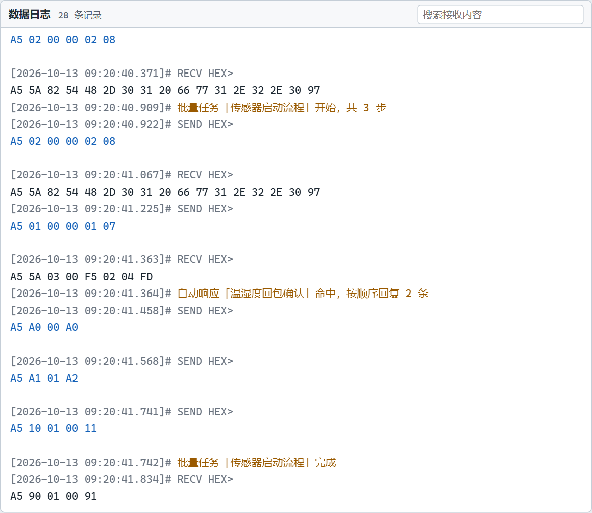

# 收到的字节怎么变成一包

> 摘要：设备调试工具把串口上陆续到达的字节，按空闲时间合并成一条日志。本文讲分包超时、日志模式、HEX / ASCII、接收不显示，以及「保存当前画面」和「接收保存到文件」两条留档路。

串口上的字节是流，不是一帧一帧送进软件的。传感器可能先到 3 个字节，过几毫秒再把剩下的补齐。超时设得太短，一帧会被拆成好几条；设得太长，两帧会粘成一条。自动应答和 `on_receive` 都是对着「合成之后的这一包」工作的，包的边界不对，后面的规则和脚本也会跟着错。

默认等 20 毫秒。这段时间里没有新字节，就把已经到齐的内容收成一条。

---

## 日志长什么样

中间是数据日志。默认「按日志模式显示」，每条两行：上一行是毫秒时间戳和方向，下一行是数据。

三种行颜色分开：

- **接收**记成 `RECV`。
- **发送**记成 `SEND`。日志里这一行是写进串口的最终字节，已经含附加位，也已经过 `before_send`。
- **系统消息**用另一种颜色。串口打开关闭、应答命中、批量进度、脚本拦截都记在这里，例如「批量任务「传感器启动流程」开始，共 3 步」「自动响应「温湿度回包确认」命中，按顺序回复 2 条」。

关掉「按日志模式显示」后，画面只留接收数据本身，不带时间，也不显示发送和系统行。已经收到的内容会按当前的 HEX / ASCII 整页重画。ASCII 里不可打印的字节显示为 `.`。

标题行右侧是搜索框，Ctrl+F 聚焦，匹配处高亮，并显示有几处匹配。状态栏的 RX、TX 是字节数，不是条数。「复位计数」把这两个数归零，不清画面。

---

## 空闲超时，不是按长度切

左栏「接收设置」里的「分包超时」单位是毫秒，默认 20。合并规则是：

- 字节一到就放进当前这包，并把计时清掉重来。
- 安静超过设定的毫秒数，才把这包收口，写成一条 `RECV`。
- 它不认识帧头，也不按固定长度切开。帧界完全靠「中间停了一下」。

设备一帧一帧上报、帧与帧之间有空隙时，20 毫秒通常够用。设备连续不停地吐字节时，超时太短会被拆开。调到 8 毫秒以下，软件会提示「分包超时小于 8 ms，连续到达的数据可能被拆成多条显示」。超时填负数会提示「分包超时需为非负整数」，不会改掉原来的值。

一帧被拆开时，把超时加大，让整帧都落在同一次安静之前。两帧粘在一起时，把超时减小，让帧间的空隙能被认出来。协议若完全没有间隔，超时合并分不开它们，需要在脚本里自己按帧头切，那是《Lua 脚本教程》里 `on_receive` 的事。

---

## 画面上可以不画，链路仍在走

「接收数据不显示」只影响画面：接收行不画出来，标题行会标「接收不显示」。字节仍然计入 RX，`on_receive` 和自动应答照常对这一包执行。设备狂吐数据、只想让脚本或应答工作时，用这个开关，而不是把超时改成 0。

「接收区自动换行」让长行在日志区折行。「自动滚屏」在新行到来时滚到底部。Ctrl+L「清除接收」清空画面上的日志，不清 RX / TX 计数。

画面上最多留 500 条。更早的行从窗口里去掉，不会写进应用自己的运行日志。串口收发内容不会自动进 `logs/` 目录。

---

## 两条留档，不要混用

**文件 → 保存接收数据**（Ctrl+S）把当前画面里还留着的日志立刻存成文本。每行是时间、`RX` / `TX` / `SYS`，数据行带 HEX。画面上已经滚出 500 条上限的，不在这个文件里。这是一份「现在窗口里有什么」的快照，含发送和系统行。

**接收保存到文件**从勾上的那一刻开始，只缓存之后新到的接收包。每一行是时间和 HEX，不含发送、不含系统消息。取消勾选时弹出保存框，写成 `.log`。状态栏在勾选期间显示正在保存的文件名和条数。勾选之前已经在画面上的旧数据，不会补进这个文件。

取消保存对话框而不写文件时，勾选保持，缓存继续。真正写出之后，勾选才关掉。

「接收数据不显示」时，这两条路仍然能留下接收字节：Ctrl+S 保存的是缓冲里的行，保存到文件记的是新到的接收包。隐藏的是画面，不是数据。

---

## 一包收进来之后

合成一条之后，顺序是固定的：

1. 写入数据日志，RX 加上这包的字节数。勾了保存到文件，就追加一行。
2. 已启用且能编译的 `on_receive` 按脚本列表运行，输出进各自的运行日志。
3. 已启用的自动应答按列表逐条匹配。多条都命中就都回。

脚本和应答看的都是这一包合并后的字节，不是串口驱动每一次回调的碎片。分包超时改了，它们的「一包」跟着变。脚本见《Lua 脚本教程》，匹配写法见《自动应答与匹配教程》。

---

## 用起来

1. 打开串口，先保持默认 20 毫秒和日志模式，确认能看到带时间的 `RECV`。
2. 一帧被拆成几条时，把分包超时调大再收一次。两帧粘成一条时，再往下调。
3. 只要计数和自动处理、暂时不要刷屏，勾「接收数据不显示」。
4. 留这一屏的收发和系统行，用 Ctrl+S。要连续录后面的接收，勾「接收保存到文件」，结束时取消勾选再保存。

日志里的 `SEND` 用来核对发出去的最终字节；`RECV` 的每一条，就是超时收口之后的一包。后面的应答和脚本都站在这个边界上。

项目地址：https://github.com/chyi-dev/device_tools
