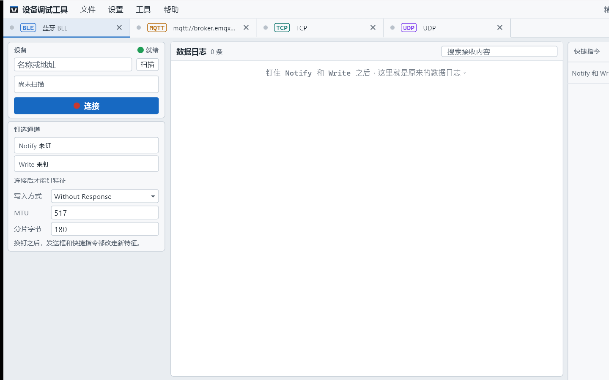
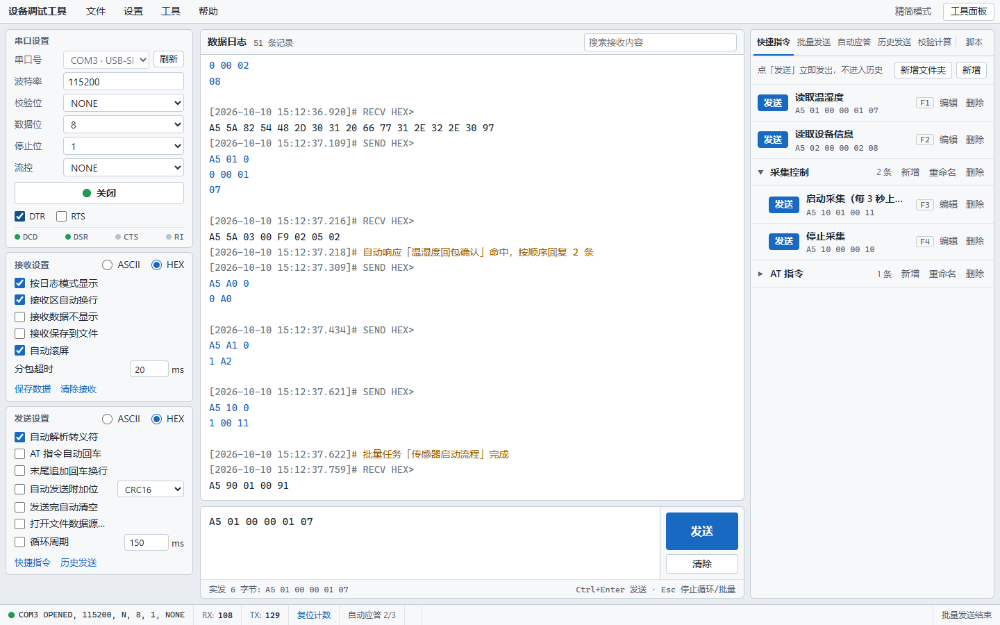

# 设备调试工具：一块工作台，五种连接

> 摘要：1.0.1 起，设备调试工具不再只有串口。顶部点「＋ 新增」，可选串口、蓝牙 BLE、MQTT、TCP、UDP。几条连接同时开着，日志和设置各记各的；串口原来的收发、校验、快捷指令、批量、应答和脚本都还在。



1.0.0 打开软件，就是串口那一页：左边设端口，中间看日志、发一帧，右边放快捷指令和脚本。对着 USB 转串口联调，够用。

工位上往往不止这一条路。传感器走串口，模组用 BLE 透传，板子再连 Broker 收遥测，或者本机起一个 TCP 服务端等设备连上来——以前要开好几个软件，窗口切来切去。这一帧刚发出去，目光已经落到另一块日志上。

1.0.1 把这些通路收进同一块工作台。

---

## 一、从「一页串口」到「多条连接」

打开软件后，顶部是连接页签。需要新通路时，点右侧「＋ 新增」，选：

- **串口**
- **蓝牙 BLE**
- **MQTT**
- **TCP**
- **UDP**

每选一次，顶部多一条页签，可以重命名。几条可以同时开着：串口收着传感器，蓝牙钉着模组，MQTT 盯着遥测——切页签只是换当前这条通路，不会把另一条的工作区带走。

每条连接各自记：数据日志、发送框（或 MQTT 发布框）、左侧设置、右侧工具面板里的指令与规则。关掉软件再打开，还在本机。

---

## 二、串口能力一个没少



串口页和 1.0.0 一样用：

- 端口参数、DTR / RTS、引脚状态
- HEX / ASCII 收发、分包超时、循环发送、文件数据源
- 六种附加位与校验计算
- 快捷指令（F1–F8）、批量发送、自动应答、历史发送
- Lua 脚本：`on_receive` 解析回包，`before_send` 改写或拦截发送

换电脑、发同事时，串口页「文件 → 导出配置…」仍可把快捷指令、自动应答、批量任务和脚本打成一个文件带走。配置包、TCP/UDP、检查更新与激活，见第三篇。

---

## 三、五种连接，右侧工具不一样

每种连接中间都是「看日志 + 发一帧」的手感，右侧工具按协议裁过：

| 连接 | 左侧先做什么 | 右侧有什么 | 没有什么 |
|------|--------------|------------|----------|
| 串口 | 选端口、设波特率与帧格式 | 快捷指令、批量、自动应答、历史、校验计算、脚本 | — |
| 蓝牙 BLE | 扫描、连接，钉住 Notify 和 Write | 快捷指令、批量、自动应答、历史、脚本 | 校验计算 |
| MQTT | 填 Broker，备好订阅与发布主题 | 订阅、快捷发布、历史、脚本 | 批量、自动应答、校验计算 |
| TCP | 客户端或服务端，打开连接 | 快捷指令、批量、自动应答、历史、脚本 | 校验计算 |
| UDP | 填本端与远端地址端口 | 同上 | 校验计算 |

记三条就够：

1. **校验计算只在串口。**
2. **批量和自动应答：串口、蓝牙、TCP、UDP 有；MQTT 没有。**
3. **脚本都在。** 串口 / 蓝牙 / TCP / UDP 用 `on_receive` / `before_send`；MQTT 用 `on_message` / `before_publish`。

蓝牙怎么钉特征、MQTT 怎么订主题，见下一篇。TCP/UDP 与配置、更新、激活，见第三篇。

---

## 四、窗口还是那熟悉的三栏

```
菜单栏
├─ 顶部        连接页签 +「＋ 新增」
├─ 左栏        当前连接的设置
├─ 中间        数据日志 + 发送 / 发布框
└─ 右栏        当前连接的工具面板
状态栏         连接状态、RX / TX 等
```

精简模式可收起左栏；工具面板可单独隐藏。主题仍是白底经典、黑底经典。界面语言：简体中文 / English。平台：Windows、macOS、Linux。

---

## 五、怎么拿到 1.0.1

- 项目与安装包：https://github.com/chyi-dev/device_debug_tools
- **Windows**：安装后可在「帮助 → 检查更新」里直接下载并安装。
- **macOS / Linux**：检查更新会打开发布页，按平台下载。

正式**激活后使用期一年**；到期后功能照常可用，页签下方**仅提示需要重新激活**。详情见第三篇。

---

## 从哪里开始

如果以前只用串口：打开 1.0.1，串口页照旧用；需要第二条路时点「＋ 新增」即可。

如果工位上同时有串口和无线：先开串口确认设备在线，再加一条蓝牙或 MQTT，两条日志各看各的，不用再切软件。
