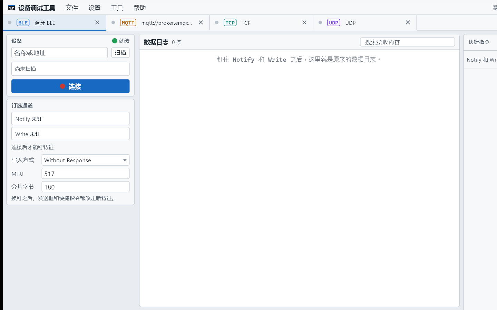
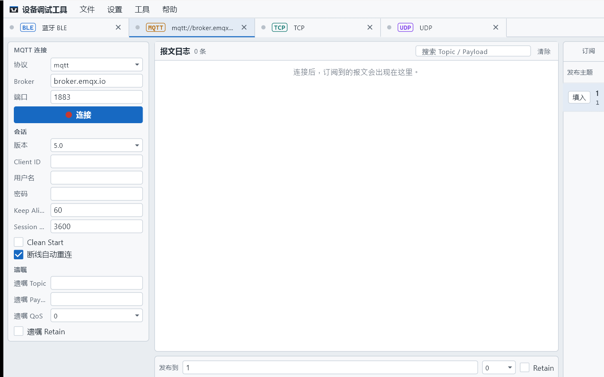

# 设备调试工具：蓝牙和 MQTT 还是原来的收发手感

> 摘要：1.0.1 把蓝牙 BLE 和 MQTT 收进同一块工作台。蓝牙先钉住 Notify 和 Write，再按串口那套手感收发；MQTT 先备好订阅和发布主题，再发 Payload。中间仍是日志和发送框，右侧放已经试通过的指令。

上一篇讲过：点「＋ 新增」就能同时开串口、蓝牙、MQTT、TCP、UDP。这一篇只说蓝牙和 MQTT——两条路上最容易踩的坑，以及和串口页哪里一样、哪里不一样。

---

## 一、蓝牙：先钉住通道，再收发

BLE 模组当无线串口用时，真正干活的是两只特征：一只 Notify（设备推数据给你），一只 Write（你往设备写）。1.0.1 的做法是：**先钉住这两只，再回到和串口一样的日志与发送框。**

### 1. 扫描并连接

1. 顶部「＋ 新增」选「蓝牙 BLE」。
2. 左栏可按名称或地址过滤，点「扫描」。
3. 选中设备，点「连接」。

适配器不可用时左栏会提示；配置仍可改，只是连不上。未连接时，发送框、快捷指令、批量都会拦住。

### 2. 钉住 Notify 和 Write

连上之后，左栏「钉选通道」把特征钉到这条连接上：

- **同时只钉各一只。** 再钉另一只，就换掉当前的。
- **只读特征不能钉成 Write。**
- 写入方式（With Response / Without Response）、MTU、分片字节留在左栏，按模组手册设。

几条硬约定：

| 情况 | 会发生什么 |
|------|------------|
| 没钉 Write | 发送框、快捷指令、批量都拦住，提示「还没有钉住 Write 特征」 |
| 没钉 Notify | 仍可走 Write 发出去；回包不进数据日志 |
| 换钉之后 | 发送框和右侧工具都改走新特征，不用改快捷指令里的内容 |

钉完之后，中间就是熟悉的数据日志和发送框。状态栏会写出连接与 MTU 等信息。

### 3. 右侧工具：和串口几乎一样

蓝牙页右侧有：

- **快捷指令**（可绑 F1–F8）——发到当前钉住的 Write
- **批量发送**——运行时写到钉住的 Write
- **自动应答**——Notify 和 Write 都钉上之后，上线帧才会自动回
- **历史发送**——只记录发送框发出的内容
- **脚本**——`on_receive` / `before_send`；钩子读的是当前钉住的特征，换钉不用改脚本

**没有校验计算。** 需要六种校验对照时，开一条串口页，或在脚本里用引擎提供的校验函数。

### 4. 典型流程

1. 扫到模组并连接。
2. 钉住透传用的 Notify 和 Write。
3. 发一帧，确认日志里有发出与回包。
4. 把常用帧存成快捷指令；把「上线要回确认」写成自动应答。
5. 需要解析或统一补校验时，到脚本页写钩子。

---

## 二、MQTT：订阅和主题先备好，再发 Payload

MQTT 不是「打开端口就收字节」，而是 **先连上 Broker，订好看哪些 Topic，再往哪个 Topic 发**。界面按这个顺序摆。

### 1. 连接 Broker

1. 「＋ 新增」选 MQTT。
2. 左栏填 Broker、端口，点「连接」。
3. 需要细调时展开三块设置：

**会话**

- 版本：3.1.1 或 5.0
- Client ID、用户名、密码
- Keep Alive、Clean Start、断线自动重连
- 选 5.0 时可填 Session Expiry

**TLS**

- 开关、CA 证书、客户端证书、私钥

**遗嘱**

- Topic、Payload、QoS、Retain

未连接时，订阅和发布都会拦住。

### 2. 订阅列表：看哪些 Topic

右侧第一个页签是**订阅**。支持通配符 `+`（单层）和 `#`（多层）。每条可单独订阅 / 退订，右键可编辑或删除。

订上之后，Broker 推下来的报文进中间的报文日志：可按 Topic / Payload 搜索，可保存成文本。

### 3. 发布主题：点「填入」不立刻发

发布主题可先存成列表。点「填入」只把 Topic 写到发布框，**不会马上发布**。QoS 和 Retain 在发送区顶栏，确认 Payload 后再点「发布」（或 Ctrl+Enter）。

这样试主题名、改 Payload 时，不会误点就把半成品发到线上。

### 4. 快捷发布、历史、脚本

MQTT 右侧是：

| 页签 | 作用 |
|------|------|
| 订阅 | 管理 Topic 订阅 |
| 快捷发布 | 常用 Payload；可沿用发布框的 Topic / QoS / Retain，也可单独覆盖 |
| 历史发送 | 只记录用「发布」按钮发出的报文；可重发或填回发布框 |
| 脚本 | `on_message` 在报文写入日志后运行；`before_publish` 可改写或返回 `nil` 拦截 |

**没有批量发送、没有自动应答、没有校验计算。** 需要按步骤连发多帧、或按内容自动回包时，用串口 / 蓝牙 / TCP / UDP 页；MQTT 页把力气花在订阅、主题和脚本钩子上。

脚本页同样有教程和样例试跑：试算只写运行日志，不会真的发布。

### 5. 典型流程

1. 连上 Broker，确认已连接。
2. 订阅设备上报的 Topic（需要时用 `+` / `#`）。
3. 存一条发布主题，点「填入」，写好 Payload，再发布。
4. 把常发的命令存成快捷发布；复杂改写用 `before_publish`。

---

## 三、和串口页对照着记

| | 串口 | 蓝牙 BLE | MQTT |
|--|------|----------|------|
| 先做什么 | 打开端口 | 连接并钉 Notify / Write | 连接 Broker，订 Topic |
| 中间主区 | 数据日志 + 发送框 | 同左 | 报文日志 + 发布框 |
| 拦住发送的条件 | 串口未打开 | 未连接，或未钉 Write | 未连接 |
| 批量 / 自动应答 | 有 | 有 | 无 |
| 校验计算 | 有 | 无 | 无 |
| 脚本钩子 | `on_receive` / `before_send` | 同左 | `on_message` / `before_publish` |

几条连接可以同时开着。例如串口盯传感器原始帧，MQTT 盯云端同一套数据是否对得上——两个页签各看各的日志，不用两个软件来回切。

---

## 下一步

- TCP 客户端 / 服务端、UDP 发送目标，以及配置、更新与激活：见《设备调试工具：TCP/UDP，以及配置、更新与激活》。
- 五种连接总览：见《设备调试工具：一块工作台，五种连接》。
- 下载：https://github.com/chyi-dev/device_debug_tools
