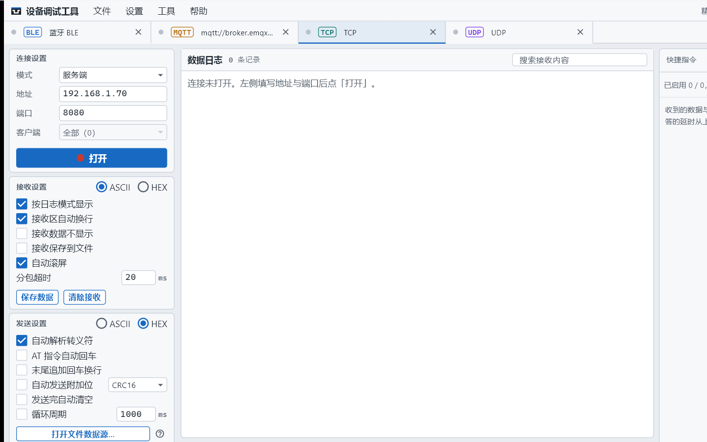
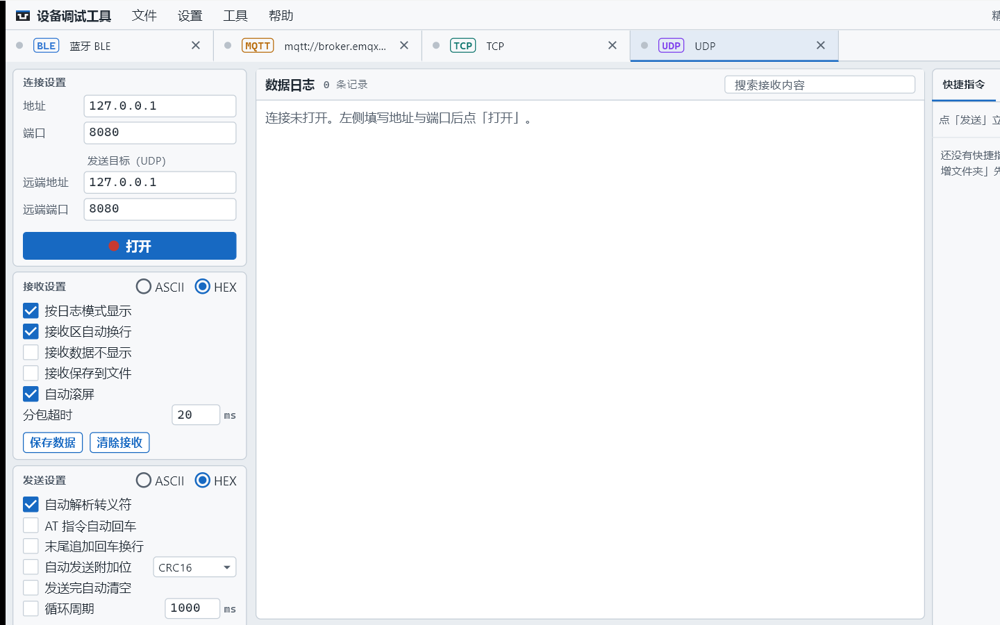
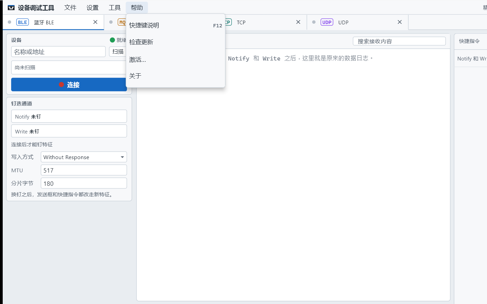
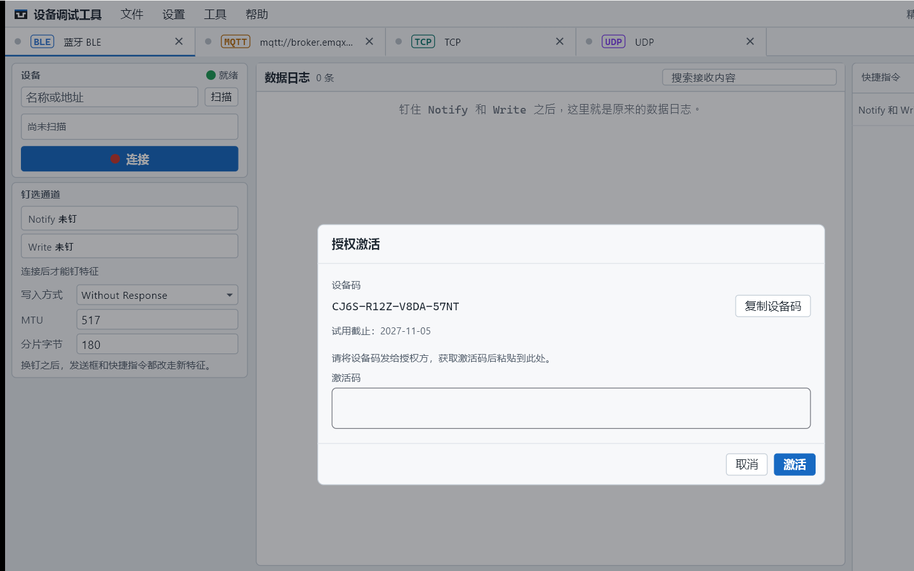

# 设备调试工具：TCP/UDP，以及配置、更新与激活

> 摘要：1.0.1 增加 TCP / UDP 页签，手感和串口接近。串口页还可导出配置包；并支持检查更新与激活。**激活后使用期一年；到期后功能照常可用，仅提示需要重新激活。**

前两篇写了五种连接总览，以及蓝牙、MQTT 怎么用。这一篇补上 TCP/UDP，再说配置导出、检查更新和激活。

---

## 一、TCP / UDP：网络上也是同一套收发

有的设备没有串口口子，直接连板子上的网口，或本机起一个服务端等设备连上来。点「＋ 新增」，选 **TCP** 或 **UDP**。

### 1. TCP：客户端或服务端

左栏可选模式：

- **客户端**：填对端地址和端口，点「打开」连上去。
- **服务端**：本机监听；有客户端接入后，可向**全部**或**单个**客户端发送。日志里能看出是哪一端来的数据。

连接未打开时，发送、快捷指令、批量、自动应答都会拦住，和串口未打开时一样。

### 2. UDP：本端绑定，远端写清

UDP 没有客户端 / 服务端之分。左栏填本端地址端口，发送还要填**远端地址和端口**。没填发送目标就点发送，会被拦住并提示先配置远端。

### 3. 右侧工具：几乎等于串口，少一个校验

TCP / UDP 右侧有：

- 快捷指令（含文件夹、F1–F8）
- 批量发送（延时、轮数、失败即停）
- 自动应答（模板 / 正则，捕获填入回复）
- 历史发送
- Lua 脚本（`on_receive` / `before_send`）

**没有校验计算。** 需要对照六种校验时，用串口页的校验计算，或在脚本里调用校验函数。

收发选项、分包超时、循环发送、文件数据源等，也尽量与串口页对齐，换通路时不用重新学一套界面。

### 4. 典型场景

- **TCP 客户端**：连设备上的调试端口，发 AT 或私有帧，看回包。
- **TCP 服务端**：板子主动连上来，你在本机回确认、跑批量自检。
- **UDP**：传感器或网关按固定地址推送，本机绑定端口收；回包时写清远端地址端口。

和串口、蓝牙可以同时开着：例如串口刷固件日志，TCP 盯应用层协议，两个页签各记各的。

---

## 二、串口配置包：一套方案一个文件

快捷指令、自动应答、批量任务和脚本攒多了，就是一套针对某款设备的调试方案。串口页「文件」菜单提供导入导出。

### 能带走什么

文件名默认是 `device-debug-config.json`。可勾选四类：

| 类别 | 内容 |
|------|------|
| 快捷指令 | 指令与文件夹 |
| 自动应答 | 全部规则 |
| 批量发送 | 全部任务 |
| 脚本 | 全部脚本（含是否启用） |

### 带不走什么

- 串口端口号、波特率等端口参数（到新电脑按新口再选）
- 历史发送、窗口布局、主题
- **蓝牙 / MQTT / TCP / UDP 的工作区**——配置包只服务串口页这一套

### 导入时注意

- 勾选的类别**整表替换**，不能撤销；不勾的保持现状。
- 清单上会写明「文件里几条、将替换当前几条」。
- 若文件里有**已启用的脚本**，导入后会立刻参与自动运行，清单下方会提醒。
- 若批量发送正在跑，导入会先停掉它。

列表里的快捷指令、应答规则、脚本支持**复制**：立刻生成一份副本再改。快捷指令的副本不占用原来的功能键。

---

## 三、检查更新

菜单「帮助 → 检查更新」会向 GitHub Releases 查询是否有新版本。

- **已是最新**：提示当前版本号。
- **有新版本**：显示当前 / 最新版本与更新说明。
  - **Windows**：可点「下载并安装」，拉取安装包并启动安装。
  - **macOS / Linux**：点「打开发布页」，按平台下载。

项目地址：https://github.com/chyi-dev/device_debug_tools

无需登录账号；出站只用于检查更新与下载安装包。

---

## 四、激活：使用期一年，到期只提示

菜单「帮助 → 激活…」打开授权对话框。

### 怎么激活

1. 打开「帮助 → 激活…」。
2. 点「复制设备码」，把设备码发给授权方。
3. 拿到激活码后粘贴进对话框，点「激活」。

设备码绑定本机；换机器需重新申请。

### 使用期一年

**正式激活后，授权使用期为一年。** 对话框里会显示到期日期，到期前正常使用，不会反复打扰。

### 到期后怎样

一年到期后不会锁死收发，也不会关掉已有功能。

页签下方会出现未激活提示条，点一下即可再次打开激活对话框，换新的激活码即可。试用结束、或授权过期，都是同一套提示——**仅提示需要激活，工作台照常用。**

首次安装起另有试用期（按一年计）。试用期内对话框会显示试用截止日期；试用结束后若尚未激活，同样只出现提示条，功能仍可用。

---

## 五、三篇串起来怎么读

| 文章 | 适合什么时候看 |
|------|----------------|
| 《设备调试工具：一块工作台，五种连接》 | 从 1.0.0 升级，想先看清 1.0.1 多了什么 |
| 《设备调试工具：蓝牙和 MQTT 还是原来的收发手感》 | 要钉 BLE 特征，或连 Broker 订 Topic |
| 本文 | 要用 TCP/UDP，或导出配置、更新、激活 |

串口本身的收发、校验、应答课和脚本课，仍以《设备调试工具：把串口调试的重复活收进一块工作台》为准；1.0.1 没有砍掉那些能力，只是在同一窗口里多了几条通路。

---

## 从哪里开始

1. 装好 1.0.1，串口页确认原来的快捷指令还在。
2. 需要网络联调时，「＋ 新增」开 TCP 或 UDP，先发通一帧再存批量。
3. 方案稳定后，串口页导出配置包备份；Windows 上养成用「检查更新」跟版本的习惯。
4. 需要正式授权时走「帮助 → 激活…」：激活后使用一年，到期只提示、不锁功能。
