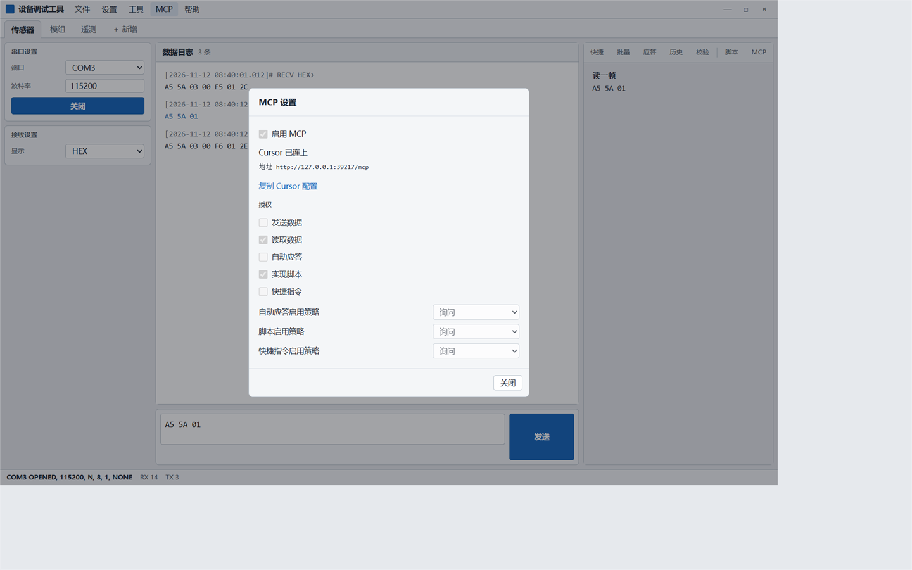
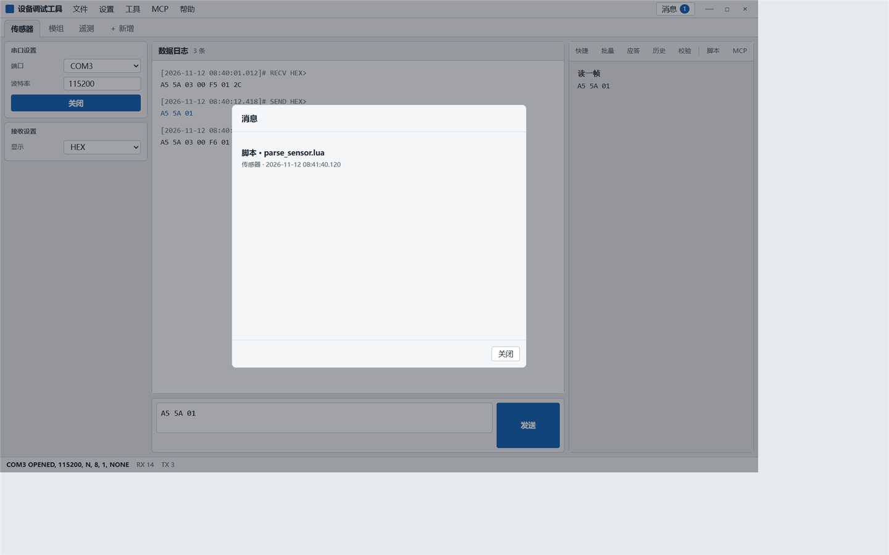
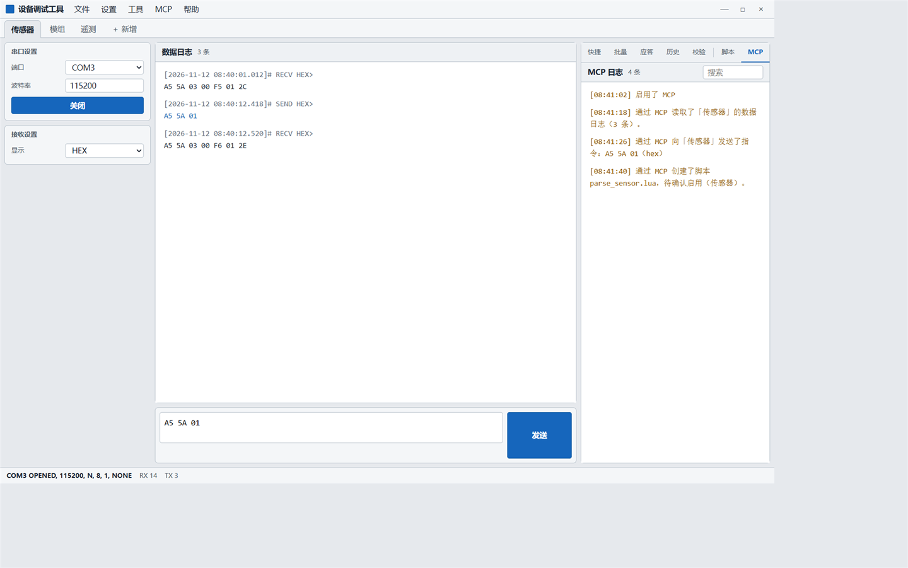

# 设备调试工具：本机 MCP 怎么用

> 摘要：菜单点「MCP」，启用后复制 Cursor 配置贴进本机 MCP。先只开读取看现场，再按需开发送与导入；询问策略下，标题栏消息里确认才启用。

上一篇说了助手能看现场、发一帧、起草脚本和规则。这一篇按界面走一遍：怎么打开、怎么连上 Cursor、怎么授权、怎么确认导入。

---

## 一、打开 MCP，复制配置

1. 菜单栏点「MCP」，打开 MCP 设置。
2. 勾选「启用 MCP」。对话框会显示本机地址，例如 `http://127.0.0.1:39217/mcp`。端口被占用时会自动改用别的，以对话框里这一行为准。
3. 点「复制 Cursor 配置」，贴进 Cursor 的 MCP 配置。内容类似：

```json
{
  "mcpServers": {
    "device_debug_tools": {
      "url": "http://127.0.0.1:39217/mcp"
    }
  }
}
```

启用后先显示「等待连接」；Cursor 连上后变成「Cursor 已连上」。



---

## 二、先开读取，再按需放开

设置里「授权」一栏各自勾选：

| 授权 | 默认 | 作用 |
|------|------|------|
| 读取数据 | 开 | 助手读指定页签的数据日志 |
| 发送数据 | 关 | 助手向指定页签发一帧 |
| 自动应答 | 关 | 助手导入自动应答规则 |
| 实现脚本 | 关 | 助手导入 Lua 脚本 |
| 快捷指令 | 关 | 助手导入快捷指令 |

建议先只留「读取数据」，让助手列出连接、读「传感器」的日志，确认看到的就是中间那份现场，再勾「发送数据」。

自动应答、脚本、快捷指令还有启用策略：默认启用 / 默认禁用 / 询问。默认是「询问」——先进列表为未启用，等你确认再打开。

---

## 三、让助手做四件事

工作台里先备好几条连接，页签名字写清楚（例如「传感器」「模组」「遥测」）。然后在 Cursor 里让助手：

1. **列出连接**：看清每条的名字、协议、是否打开。
2. **读日志**：点名某一页签，读当前数据日志快照（最多 500 条）。
3. **发一帧**：写明目标页签和数据；发出去的帧落进该连接自己的日志，不跟当前页签走。
4. **导入草稿**：例如一条脚本或一条快捷指令。策略为「询问」时，标题栏「消息」会出现待确认项；点开后决定是否启用。



每一次读取、发送、导入，右侧工具面板的「MCP」页都会记一行，方便核对助手碰到了哪一条连接。



---

## 四、几条边界

| 约定 | 说明 |
|------|------|
| 只本机 | 地址是 `127.0.0.1`，不对外网开放 |
| 不循环发送 | 带循环参数的请求会被拒绝，并在该页签日志里留系统提示 |
| 目标写清 | 用页签名称或 id；发到「传感器」不会因为当前页签是「模组」就改道 |
| MQTT | 可读写日志、发 Payload、导入脚本；不能导入自动应答和快捷指令 |
| 同名不重复 | 同名脚本 / 应答 / 快捷指令已在列表里时，不会再导入一份 |
| 口子未开 | 发送被拦住，文案与手点发送一致 |

关着「启用 MCP」时，发送和写草稿都不发生。关掉某一类授权后，对应的待确认启用也会取消（条目若已导入，仍停在未启用）。

---

## 五、激活

**激活后即可使用 MCP。** 关注公众号，私信作者即可。
