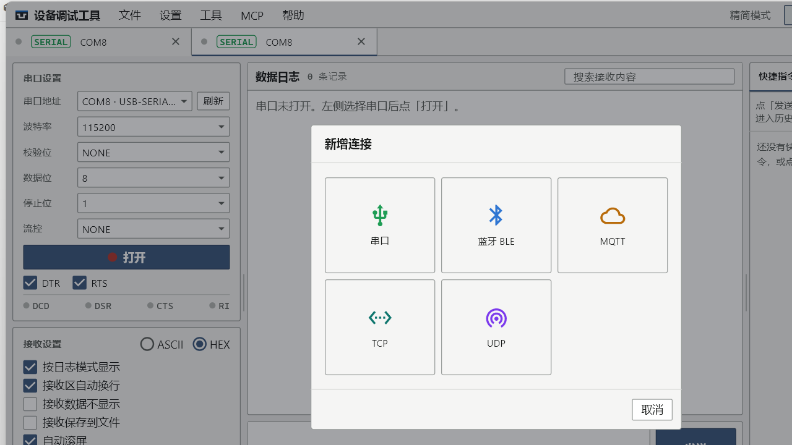
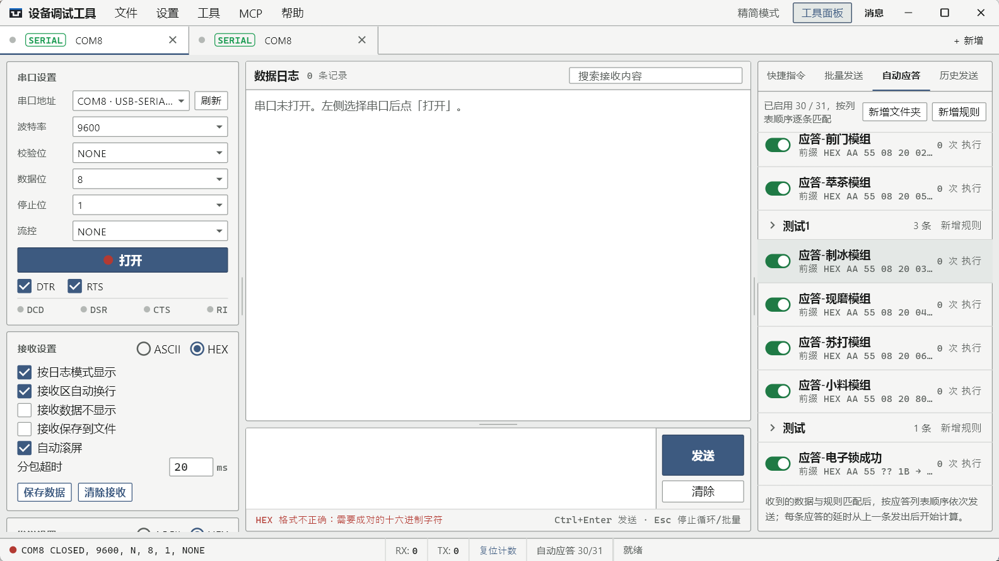
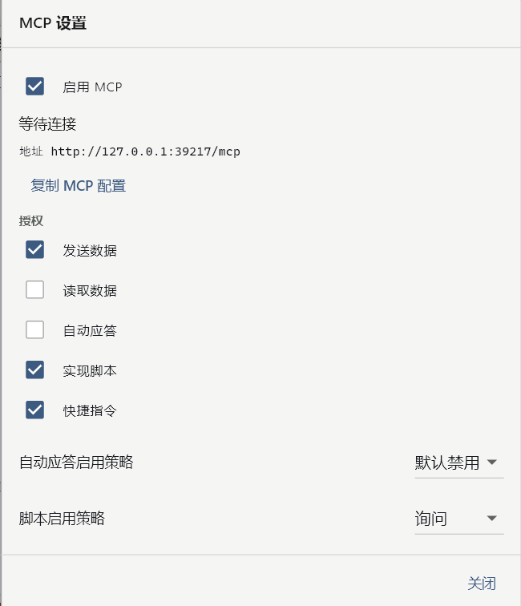

# 设备调试工具：分组、拖拽，和MCP

> 摘要：调整了界面配色和弹窗；快捷指令、自动应答可以进文件夹并拖拽整理；AI可以通过本机 MCP 看读写、发数据、写快捷指令，自动应答，脚本。

新版本把面板和弹窗按仪器台重画一遍；右侧工具支持文件夹和拖拽；本机 MCP 让 AI 连上应用，根据具体场景，实现自动化操作。

---

## 一、工作台和弹窗

浅色主题是仪器台那一套：面板、日志底、强调色统一。对话框也走同一套边框和按钮，新增连接、设置、关于都长得像同一家东西。

点顶部「＋ 新增」，弹窗改成宫格：串口、蓝牙 BLE、MQTT、TCP、UDP，点一下就多一条页签。

五种连接的收发手感没变：中间看日志、发一帧；左侧设本条连接；右侧放工具。页签可以重命名，几条可以同时开着。

---

## 二、快捷指令和自动应答：文件夹与拖拽

串口、蓝牙、TCP、UDP 的右侧工具里，快捷指令和自动应答都能「新增文件夹」。把常用帧按设备、按阶段收进一组，根目录只留经常点的几条。

自动应答这次才有文件夹；匹配仍按列表顺序逐条走，文件夹只是整理方式，不改变「谁先谁后」。

MQTT 页没有快捷指令和自动应答；脚本五种连接都有。

拖一条指令或规则时，落点是这三句：

- **放到根目录**
- **放到此文件夹**
- **插到此条之前**

文件夹也可以拖，用来调整组与组的顺序。

---

## 三、本机 MCP：让AI看见工作台

菜单栏点「MCP」，勾选「启用 MCP」。对话框会显示本机地址，例如 `http://127.0.0.1:39217/mcp`；端口被占用时会自动改用别的，以这一行为准。点「复制 MCP 配置」，AI对话中贴进本机的 MCP 配置即可。

启用后先显示「等待连接」；如 Cursor 连上后变成「Cursor 已连上」。

授权默认只开「读取数据」。发送数据、自动应答、实现脚本、快捷指令默认关着；后三类的启用策略默认是「询问」——先进列表为未启用，标题栏「消息」里确认后才打开。

工作台里先把页签名字写清楚，再让助手做这四件事：

1. **列出连接**：名字、协议、是否打开。
2. **读日志**：点名某一页签，读当前数据日志快照（最多 500 条）。
3. **发一帧**：写明目标页签和数据；帧落进该连接自己的日志，不跟当前页签走。
4. **导入草稿**：脚本、自动应答或快捷指令。策略为「询问」时，在标题栏「消息」里决定是否启用。

几条边界：

| 约定 | 说明 |
|------|------|
| 只本机 | 地址是 `127.0.0.1`，不对外网开放 |
| 不循环发送 | 带循环参数的请求会被拒绝 |
| 目标写清 | 用页签名称或 id；发到「传感器」不会因为当前页签是「模组」就改道 |
| MQTT | 可读写日志、发 Payload、导入脚本；不能导入自动应答和快捷指令 |
| 同名不重复 | 同名条目已在列表里时，不会再导入一份 |

关着「启用 MCP」时，发送和写草稿都不发生。关掉某一类授权后，对应的待确认启用也会取消。

---

## 四、激活：MCP 要钥匙，调试台照常用

首次安装起有 **30 天试用**。试用期内，串口、蓝牙、MQTT、TCP、UDP 照常用；**没有有效激活码时，MCP 不能开**——点「MCP」会弹出支持窗，进不了设置。

试用结束后若尚未激活，页签下方会出现提示条，点一下可打开激活对话框。收发、快捷指令、自动应答、脚本都不会被锁死。

**需要 MCP 时：关注公众号，私信作者获取激活码。**

项目与安装包：https://github.com/chyi-dev/device_debug_tools
