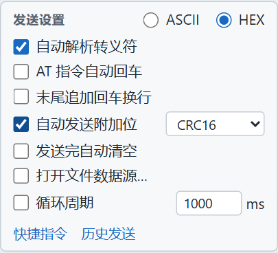
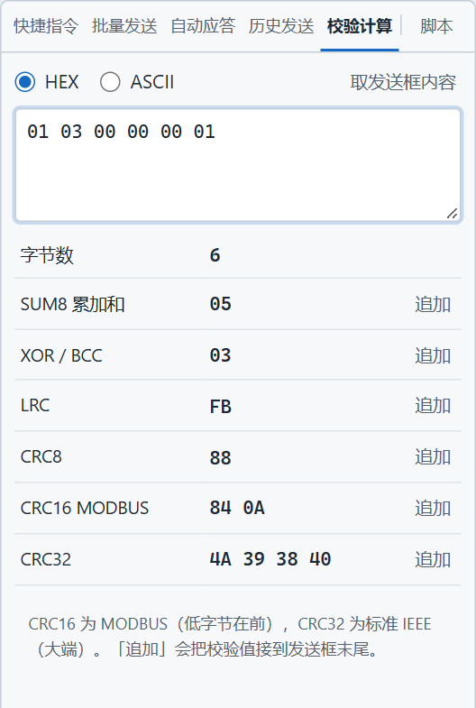

# 六种校验怎么选

> 摘要：设备调试工具对同一段数据提供 SUM8、XOR/BCC、LRC、CRC8、CRC16、CRC32 六种校验。左栏「自动发送附加位」在发送时自动接上；右侧「校验计算」用来对照手册，再决定要不要写回发送框。

协议手册末尾那一两个字节，最容易对不齐：有的是简单累加，有的是 Modbus CRC，而且 CRC16 还要求低字节在前。每次手算，或者在另一个网页计算器里粘贴，帧一多就对不上。

软件里有两个入口，做的事不一样。一个是发送时自动附加，一个是先把六种结果摊开看。下面用同一帧 `01 03 00 00 00 01` 把六种都算出来。这是一条常见的 Modbus 读保持寄存器请求，不含校验。

---

## 同一帧的六种结果

| 名称 | 算法 | 这一帧的结果 |
|------|------|----------------|
| SUM8 | 各字节相加，取低 8 位，1 字节 | `05` |
| XOR/BCC | 各字节异或，1 字节 | `03` |
| LRC | SUM8 的二进制补码，1 字节 | `FB` |
| CRC8 | 多项式 `0x07`，初值 0，1 字节 | `88` |
| CRC16 | MODBUS，低字节在前，2 字节 | `84 0A` |
| CRC32 | IEEE，大端，4 字节 | `4A 39 38 40` |

`01 + 03 = 04`，再加最后的 `01` 得 `05`，所以 SUM8 是 `05`。LRC 是 `05` 的补码 `FB`，使两者相加的低 8 位为 0。CRC16 的 `84 0A` 已经是低字节在前，接到帧尾即可，不用再对调。

---

## 自动发送附加位

左栏「发送设置」里勾上「自动发送附加位」，旁边六选一。发送框发出去时，软件用当前选项算一次，接在数据末尾、回车换行之前。

上图选的是 CRC16。输入仍是 `01 03 00 00 00 01`，底部预览已经是 `实发 8 字节：01 03 00 00 00 01 84 0A`。输入框不用把 `84 0A` 再写一遍。

这一项作用在发送框和文件数据源上。文件按原始字节整份发送，校验接在整个文件后面。快捷指令、批量发送、自动应答不读这个开关，存进去的 HEX 是什么就发什么。四条路径的差别见《发出去的那一帧》。

要让快捷指令、批量和自动应答也带同一种校验，有两条路：把校验字节写进指令或应答数据里；或者用一条 `before_send` 在写出串口前统一追加。脚本写法在《Lua 脚本教程》第六课，那里的样例帧同样是 `01 03 00 00 00 01`，试算结果也是 `84 0A`。界面上的 CRC16 和脚本里的 `crc16` 是同一套 Modbus 算法。

---

## 校验计算

右侧工具面板的「校验计算」不发送。它把一段 HEX 的六种结果一次列出来，用来对手册里的示例帧。串口开不开都能算。

- 输入框同样支持 HEX / ASCII。「取发送框内容」把当前发送框抄过来。
- 每一行右侧是结果，「追加」把**原数据和这一行的校验**接在一起，以 HEX 写回发送框。
- 追加会退出文件数据源。发送框变成例如 `01 03 00 00 00 01 84 0A`。
- 面板底部的说明与上表一致：CRC16 为 MODBUS（低字节在前），CRC32 为标准 IEEE（大端）。

格式不对时，这里直接提示「请输入成对的十六进制字符」，不会给出半截结果。

---

## 不要算两遍

「追加」写进发送框的，已经是带校验的正文。若左栏「自动发送附加位」仍勾着 CRC16，下一次发送会把这 8 个字节再算一遍 CRC，末尾变成 10 字节，设备和手册都对不上。

两种用法挑一种：

- 校验留在左栏，发送框里只写数据区。换协议时改下拉框即可。
- 校验写进正文（自己算好，或点「追加」）。写好后关掉「自动发送附加位」。快捷指令和批量步骤本来就不套左栏附加位，校验就放在步骤数据里，和上图这种 `84 0A` 一样写死。

回车换行加在校验之后，不参与这六种计算。先对校验，再决定要不要末尾 `0D 0A`。

---

## 用起来

1. 从手册抄一帧已知校验的示例，放到「校验计算」。
2. 看哪一行和手册末尾一致。Modbus RTU 对 CRC16 那一行，`84 0A` 这种顺序可以直接用。
3. 日常发送：左栏选中该算法，发送框只留数据区，看实发预览确认接上了。
4. 要存成快捷指令或批量步骤：点「追加」，把带校验的整帧存进去，左栏附加位关掉。

对手册时不用开串口。预览或校验计算里的字节和手册一致之后，再打开串口发出去。

---

六种算法里，现场最常碰到的是 SUM8、XOR/BCC 和 Modbus CRC16。先用校验计算对上手册的那一行，再决定是让发送框自动附加，还是把结果写进指令正文。两条路同时开着，校验就会多算一次。

项目地址：https://github.com/chyi-dev/device_tools
