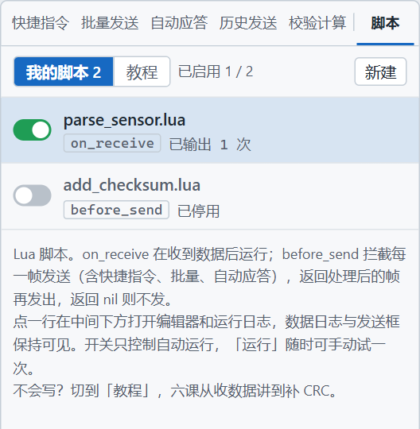
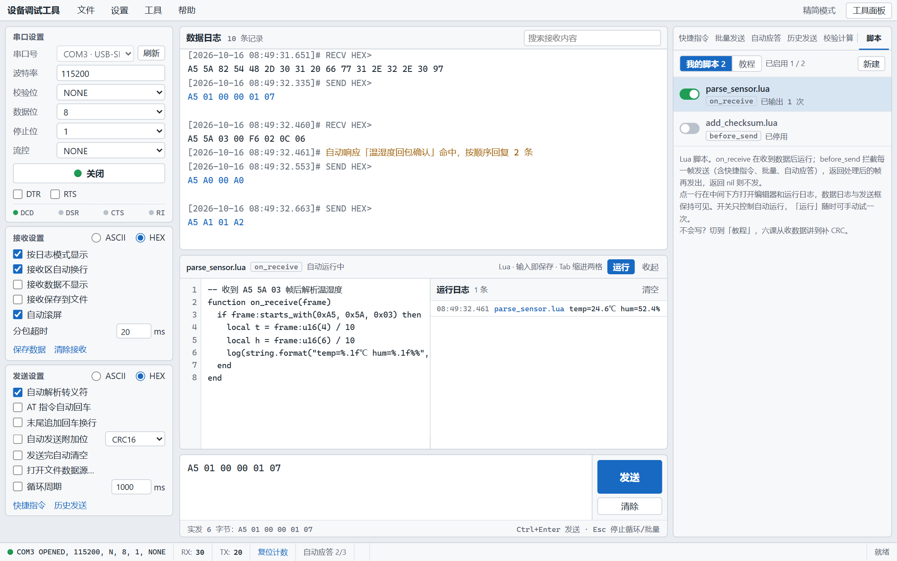
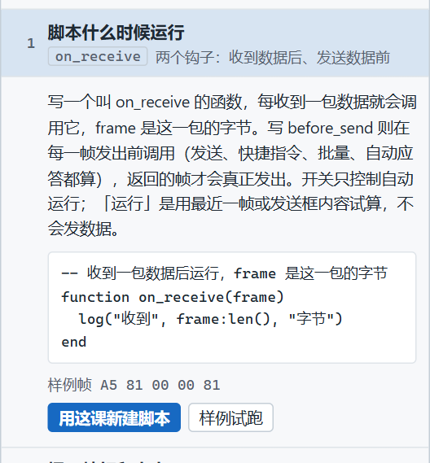
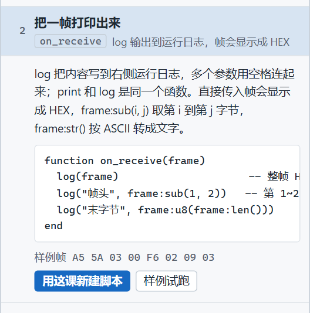
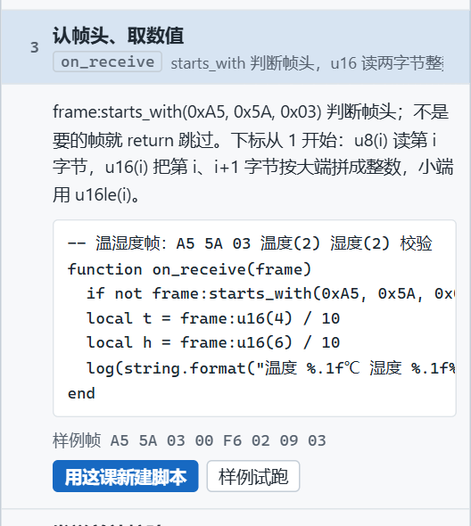
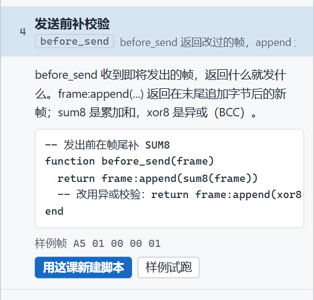
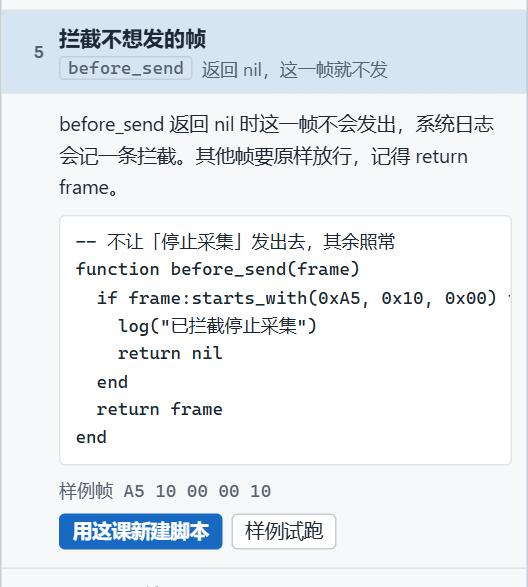
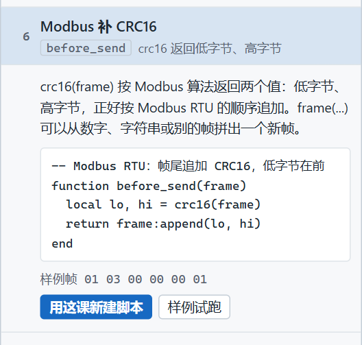

# Lua 脚本教程

> 摘要：设备调试工具的脚本用 Lua 处理串口收发。on_receive 解析收到的帧，before_send 在发出前改写或拦截。本文按软件里的六课，从打印一帧讲到 Modbus CRC16。

调设备时，有两件事变来变去：回包要换算成温度湿度才能看懂；发出去的每一帧末尾都要补同一种校验。把这两件事写成脚本，收到或发送时自动跑，不用每次手算。

右侧工具面板最右边是「脚本」，和前面的页签用竖线隔开。脚本语言是 Lua，只有两个钩子。

---

## 两个钩子

| 钩子 | 什么时候运行 | 返回值 |
|------|------|------|
| `on_receive(frame)` | 一包数据合并完成之后、自动应答匹配之前 | 忽略 |
| `before_send(frame)` | 每一帧写出串口之前 | 返回的帧才会发出。返回 `nil` 则这一帧不发 |

`before_send` 对所有发送路径都生效：发送框、快捷指令、批量发送、自动应答都会经过。多个 `before_send` 按列表从上到下串联。某一条出错，后面的不再跑，这一帧也不发。

开关只控制**自动运行**。关掉后仍可点「运行」试算，试算不会真正发数据：

- 有 `on_receive` 时，用最近一包接收来跑。还没收到过数据会提示。
- 有 `before_send` 时，用发送框里的合法 HEX 来跑，并写明改写结果或「会被拦截」。

---

## 界面长什么样



列表上方是「我的脚本 / 教程」。每一行是开关、脚本名、钩子名和输出次数。第一次打开会有两条示例：`parse_sensor.lua` 默认启用，`add_checksum.lua` 默认停用。

点一行，编辑器停靠在数据日志和发送框之间。数据日志和发送框保持可见。输入即保存，Tab 缩进两格。右边是运行日志。



上图里 `parse_sensor.lua` 已经在跑：收到 `A5 5A 03` 开头的温湿度帧后，运行日志直接写出温度和湿度，不用对着 HEX 心算。

---

## 帧上能用的写法

字节下标从 **1** 开始。可以直接写 `0xA5`。把 `frame` 交给 `log` 会印成 HEX。`print` 和 `log` 是同一个函数。

| 写法 | 含义 |
|------|------|
| `frame:len()` | 字节数 |
| `frame:u8(i)` | 第 i 字节，越界当 0 |
| `frame:u16(i)` | 第 i、i+1 字节，大端 |
| `frame:u16le(i)` | 同上，小端 |
| `frame:starts_with(0xA5, 0x5A)` | 帧头是否一致 |
| `frame:sub(i, j)` | 第 i 到第 j 字节 |
| `frame:append(...)` | 末尾追加后的新帧，原帧不变 |
| `frame:hex()` / `frame:str()` | 转成 HEX 字符串 / 按字节转成文字 |
| `sum8(frame)` / `xor8(frame)` | 累加和低 8 位 / 异或 |
| `crc16(frame)` | Modbus CRC16，返回低字节、高字节 |

下面六课与软件里的「教程」顺序一致。点「用这课新建脚本」会按课生成一份停用的脚本；点「样例试跑」只把样例帧交给代码，输出写进运行日志，不发数据。

---

## 第一课：脚本什么时候运行



写一个叫 `on_receive` 的函数，每收到一包就会调用它，`frame` 是这一包的字节。

```lua
-- 收到一包数据后运行，frame 是这一包的字节
function on_receive(frame)
  log("收到", frame:len(), "字节")
end
```

样例帧 `A5 81 00 00 81`，运行日志写出「收到 5 字节」。

---

## 第二课：把一帧打印出来



`log` 把内容写到运行日志，多个参数用空格连起来。直接传入帧显示成 HEX。`frame:sub(i, j)` 取第 i 到第 j 字节。

```lua
function on_receive(frame)
  log(frame)                     -- 整帧 HEX
  log("帧头", frame:sub(1, 2))   -- 第 1~2 字节
  log("末字节", frame:u8(frame:len()))
end
```

样例帧 `A5 5A 03 00 F6 02 09 03`，输出三行：整帧 HEX、`帧头 A5 5A`、`末字节 3`。

---

## 第三课：认帧头、取数值



不是要的帧就 `return` 跳过。`u16(i)` 把第 i、i+1 字节按大端拼成整数，再除以 10 得到带一位小数的读数。

```lua
-- 温湿度帧：A5 5A 03 温度(2) 湿度(2) 校验
function on_receive(frame)
  if not frame:starts_with(0xA5, 0x5A, 0x03) then return end
  local t = frame:u16(4) / 10
  local h = frame:u16(6) / 10
  log(string.format("温度 %.1f℃ 湿度 %.1f%%", t, h))
end
```

样例帧 `A5 5A 03 00 F6 02 09 03`：

- 第 4–5 字节 `00 F6` 是 246，÷10 为 **24.6℃**
- 第 6–7 字节 `02 09` 是 521，÷10 为 **52.1%**
- 最后一字节是校验，这段解析不用它

---

## 第四课：发送前补校验



`before_send` 收到即将发出的帧，**返回什么就发什么**。`append` 得到的是新帧，原帧不变。`sum8` 是各字节相加后的低 8 位，`xor8` 是异或。

```lua
-- 发出前在帧尾补 SUM8
function before_send(frame)
  return frame:append(sum8(frame))
  -- 改用异或校验：return frame:append(xor8(frame))
end
```

样例帧 `A5 01 00 00 01`，试算结果是 `A5 01 00 00 01 A7`（未真正发送）。`A7` 就是这五个字节的 SUM8。

---

## 第五课：拦截不想发的帧



返回 `nil`，这一帧不发出，数据日志记一条拦截。其余帧必须原样 `return frame`。忘了这一句，其他帧也会被当成拦截。

```lua
-- 不让「停止采集」发出去，其余照常
function before_send(frame)
  if frame:starts_with(0xA5, 0x10, 0x00) then
    log("已拦截停止采集")
    return nil
  end
  return frame
end
```

样例帧 `A5 10 00 00 10` 会被拦截。快捷指令、批量和自动应答里的同一帧头同样过不了这个钩子。

---

## 第六课：Modbus 补 CRC16



`crc16(frame)` 按 Modbus 算法返回两个值：低字节、高字节，正好按 Modbus RTU 的顺序追加。

```lua
-- Modbus RTU：帧尾追加 CRC16，低字节在前
function before_send(frame)
  local lo, hi = crc16(frame)
  return frame:append(lo, hi)
end
```

样例帧 `01 03 00 00 00 01`，试算结果是 `01 03 00 00 00 01 84 0A`。`84 0A` 就是这段的 Modbus CRC16，低字节在前。

---

## 写脚本时的限制

- 不能调用 `os.execute`、`os.exit`、`os.remove`、`os.rename`、`os.tmpname`。
- 死循环会在大约 200 万条指令后被中止，运行日志写「执行超过指令上限」。
- 编译失败的脚本不参与自动运行，同一版代码的错误只记一次。
- 下标从 1 开始。`0x` 写法可以直接用。

---

## 用起来

1. 右侧打开「脚本」，切到「教程」。
2. 点开一课。想看结果就点「样例试跑」；想改就点「用这课新建脚本」。新建的脚本默认停用，并打开编辑器。
3. 改完后打开那一行的开关，脚本才参与自动运行。
4. 解析回包用 `on_receive`；要给所有发出去的帧补校验或拦某一类帧，用 `before_send`。

先用第三课把一帧温湿度读成人能看的数，再用第六课给 Modbus 请求自动补 CRC。两件事都稳定之后，再写拦截。

项目地址：https://github.com/chyi-dev/device_tools
