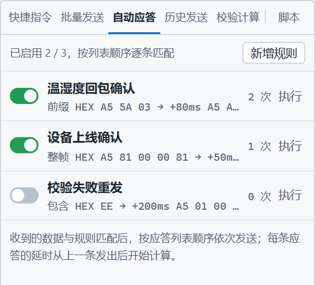
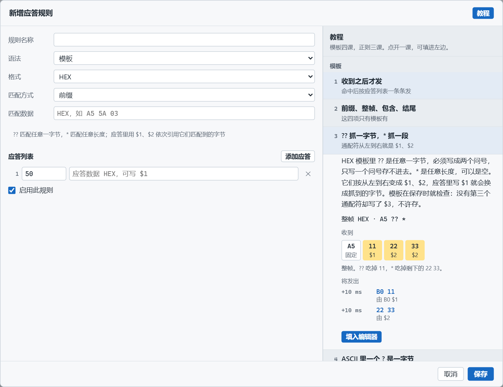
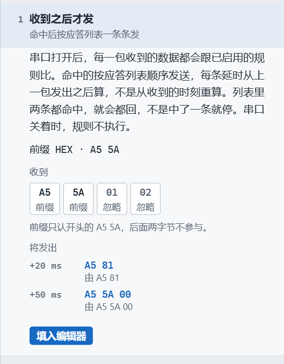
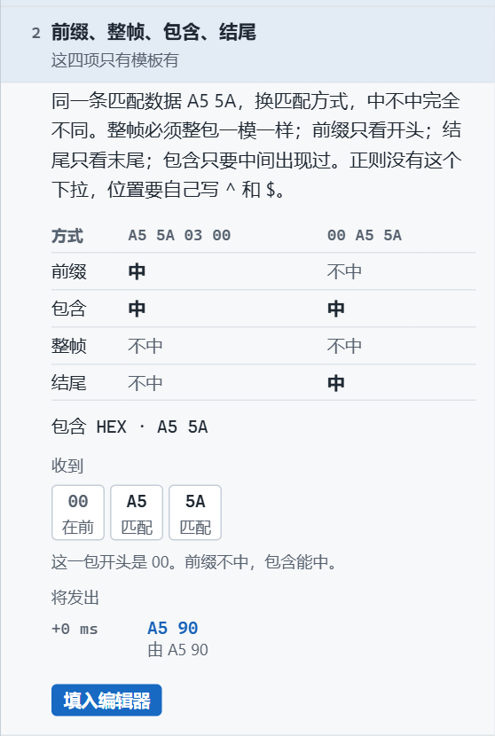
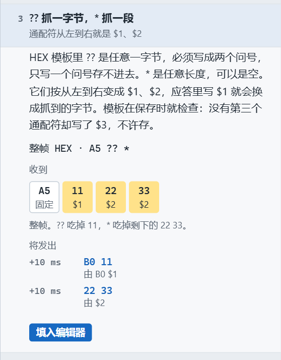
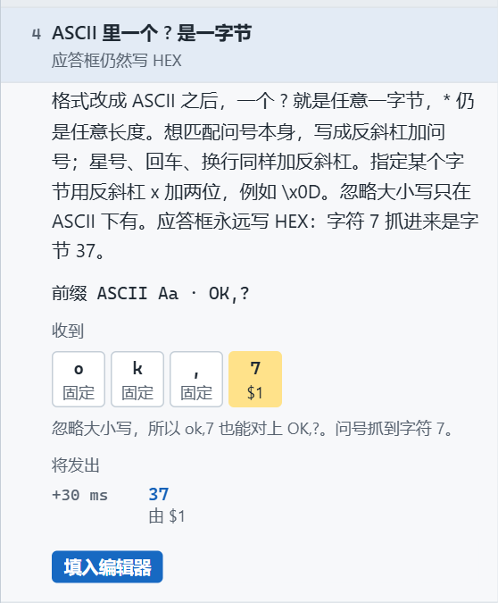
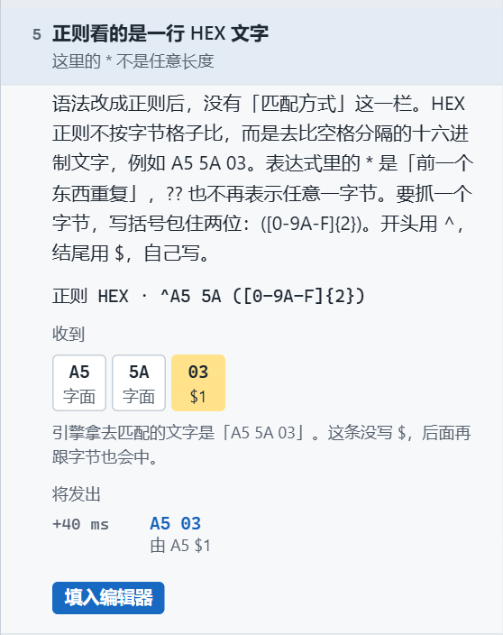
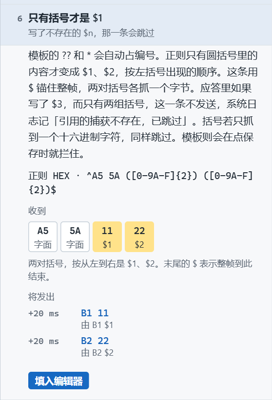
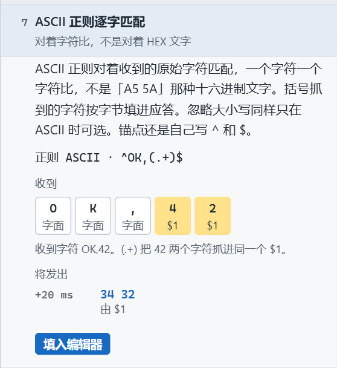

# 自动应答与匹配教程

> 摘要：设备调试工具的自动应答，能在串口收到指定帧后按规则自动回包。本文介绍功能怎么用，并按软件里的七课讲清模板与正则的匹配写法，含 `$1` 捕获与常见易错点。

调设备时，常见一类活：设备上线要立刻回确认，传感器每报一包温湿度也要回一个应答。盯着日志手点发送，既慢又容易漏。

自动应答就是做这件事的：串口打开后，每一包接收都会和已启用的规则比对；命中后按应答列表依次发出，延时从上一条发出之后算起。列表里多条规则都命中，就会都回，不是中了一条就停。串口关着时，规则不执行。

---

## 界面长什么样

右侧工具面板切到「自动应答」，就是规则列表。

- 每条规则左侧是开关，只控制这一条是否参与匹配。
- 中间写清楚：匹配方式、格式、匹配数据，以及命中后要发的应答和延时。
- 右侧是命中次数，和「执行」按钮（不靠真实接收，手动触发一次）。
- 顶部显示「已启用几条 / 总共几条」。

点「新增规则」，对话框左边是表单，右上角有「教程」。点开「教程」后对话框加宽，右边出现七课：模板四课、正则三课。

点一课展开说明、字节格和「将发出」的结果。点「填入编辑器」只写入左边表单，还要再点「保存」才会进规则列表。

---

## 规则怎么配

配一条规则，大致要定五件事：

| 项 | 说明 |
|------|------|
| 语法 | **模板**或**正则** |
| 格式 | **HEX**或**ASCII** |
| 匹配方式 | 仅模板有：前缀 / 整帧 / 包含 / 结尾。正则没有这一栏，位置自己写 `^` 和 `$` |
| 匹配数据 | 用来比对收到的那一包 |
| 应答列表 | 一条或多条；每条有延时（毫秒）和应答数据 |

几个硬约定：

- **应答框永远写 HEX**。哪怕匹配用的是 ASCII，回回去的也是十六进制字节。
- 应答里可以写 `$1`、`$2`，填入通配符或括号抓到的内容。
- **模板**在点「保存」时就会检查：没有第三个通配符却写了 `$3`，不许存。
- **正则**若引用了不存在的 `$n`，这一条应答跳过不发，系统日志记「引用的捕获不存在，已跳过」。

下面按软件里的七课顺序讲匹配。每课的样例与界面一致，可直接对照截图。

---

## 第一课：收到之后才发

自动应答不是定时器，也不是一打开串口就狂发。它只在**收到一包数据、并且规则命中**之后，才按应答列表一条条发。

- 延时从**上一包发出之后**起算，不是从收到的时刻重算。
- 列表里两条规则都命中，两条都会回。
- 串口关着，整条链路不跑。

样例：前缀匹配 `A5 5A`，收到 `A5 5A 01 02` 后，先等 20 ms 发 `A5 81`，再等 50 ms 发 `A5 5A 00`。前缀只认开头的 `A5 5A`，后面两字节不参与比较。

---

## 第二课：前缀、整帧、包含、结尾

这四种匹配方式**只有模板有**。同一条匹配数据 `A5 5A`，换方式，中不中完全不同：

| 方式 | `A5 5A 03 00` | `00 A5 5A` |
|------|----------------|------------|
| 前缀 | 中 | 不中 |
| 包含 | 中 | 中 |
| 整帧 | 不中 | 不中 |
| 结尾 | 不中 | 中 |

- **整帧**：整包必须一模一样，多一个字节都不行。
- **前缀**：只看开头。
- **结尾**：只看末尾。
- **包含**：中间出现过就算。

正则没有这个下拉框。要锚定开头或结尾，自己在表达式里写 `^` 和 `$`。

---

## 第三课：`??` 抓一字节，`*` 抓一段

HEX 模板里两个通配符：

- `??`：任意**一**字节，必须写成两个问号。只写一个问号存不进去。
- `*`：任意长度，可以是空。

它们按从左到右变成 `$1`、`$2`。应答里写 `$1`，就会换成抓到的字节。

例：整帧匹配 `A5 ?? *`，收到 `A5 11 22 33`：

- `$1` = `11`（`??` 吃掉）
- `$2` = `22 33`（`*` 吃掉剩下的）

应答写 `B0 $1` 会发出 `B0 11`；再写 `$2` 会发出 `22 33`。保存时若没有第三个通配符却写了 `$3`，对话框会拦住。

---

## 第四课：ASCII 里一个 `?` 是一字节

格式改成 ASCII 之后：

- 一个 `?` 就是任意一字节（不是两个问号）。
- `*` 仍是任意长度。
- 要匹配问号、星号、回车、换行本身，写成 `\?` `\*` `\r` `\n`。指定某个字节用 `\xHH`。
- 「忽略大小写」只有 ASCII 下才有。
- **应答框仍然写 HEX**。字符 `7` 抓进来是字节 `37`。

样例：前缀 `OK,?`，勾上忽略大小写。收到 `ok,7` 也能对上，`$1` 是字符 `7`，应答 `$1` 发出 `37`。

---

## 第五课：正则看的是一行 HEX 文字

语法改成正则后，没有「匹配方式」这一栏。

**HEX 正则**不按字节格子比，而是去比空格分隔的大写十六进制文字，例如 `A5 5A 03`。

因此：

- 表达式里的 `*` 是「前一个东西重复」，**不是**模板里的任意长度。
- `??` 也不再表示任意一字节。
- 要抓一个字节，写括号包住两位：`([0-9A-F]{2})`。
- 开头用 `^`，结尾用 `$`，自己写。

样例：`^A5 5A ([0-9A-F]{2})`，收到 `A5 5A 03` 时，引擎拿去匹配的文字是「A5 5A 03」，括号抓到 `03`，应答 `A5 $1` 发出 `A5 03`。这条没写末尾 `$`，后面再跟字节也会中。

---

## 第六课：只有括号才是 `$1`

模板的 `??` 和 `*` 会自动占编号。正则不一样：**只有圆括号里的内容**才变成 `$1`、`$2`，按左括号出现的顺序。

样例：`^A5 5A ([0-9A-F]{2}) ([0-9A-F]{2})$`

- 收到 `A5 5A 11 22`
- `$1` = `11`，`$2` = `22`
- 应答 `B1 $1` → `B1 11`，`B2 $2` → `B2 22`

若应答里写了 `$3`，而只有两组括号，这一条**不发送**，系统日志记「引用的捕获不存在，已跳过」。括号若只抓到一个十六进制字符，同样跳过。模板则会在点保存时就拦住，正则是运行时跳过。

末尾的 `$` 表示整帧到此结束，多一个字节就不会中。

---

## 第七课：ASCII 正则逐字匹配

ASCII 正则对着收到的**原始字符**逐字匹配，不是「A5 5A」那种十六进制文字。

- 括号抓到的字符，按字节填进应答。
- 忽略大小写同样只在 ASCII 时可选。
- 锚点还是自己写 `^` 和 `$`。

样例：`^OK,(.+)$`，收到字符 `OK,42`。`(.+)` 把 `42` 两个字符抓进同一个 `$1`，应答 `$1` 发出 `34 32`（字符 `4` 和 `2` 的字节）。

---

## 用起来

1. 右侧打开「自动应答」，点「新增规则」。
2. 点标题栏「教程」，按课展开；合适的课点「填入编辑器」，再按设备协议改匹配数据和应答。
3. 点「保存」。确认开关是打开的。
4. 打开串口。设备一发匹配的帧，日志里会出现系统行「自动响应「某规则」命中…」，随后是 `SEND`。
5. 状态栏右侧可以看到「自动应答 已启用数/总数」。

想先验证规则、又不想等设备：在列表里点该行的「执行」，会按这条规则的应答列表发一遍（仍要求串口已打开）。

---

自动应答适合把「收到什么就回什么」从手上挪进规则表。模板四课覆盖大多数帧头、通配和 ASCII 场景；需要更灵活的锚点或分组时，再用正则三课。从「填入编辑器」开始改，比从空白表单起步快很多。
