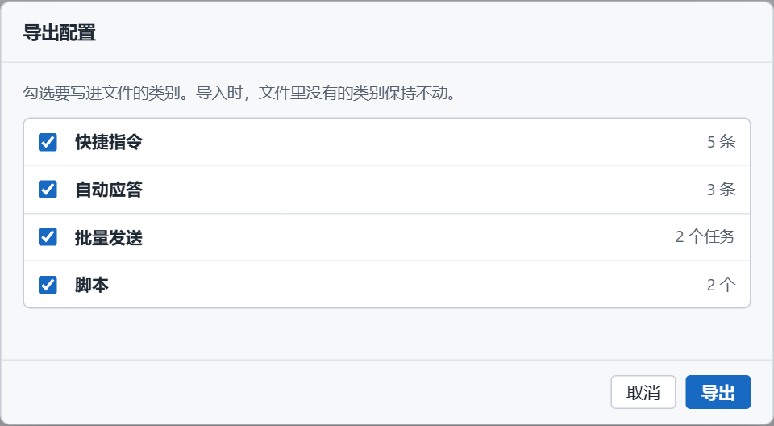

# 一套设备方案怎么带走

> 摘要：文件菜单里的「导出配置」「导入配置」把快捷指令、自动应答、批量任务和脚本打成一个 JSON。导入时按类别整表替换。串口参数、历史和窗口布局不在这个文件里。

快捷指令、应答规则、上电流程和解析脚本配齐之后，就是一套针对某款设备的调试方案。换一台电脑，或把方案发给同事，不需要逐条重录。导出一个文件，对方勾选要替换的类别，导入即可。

---

## 导出：四类分开勾

文件菜单 →「导出配置…」。

对话框列出四类，每类前面一个勾。右侧是当前工作区里的数量：

| 类别 | 怎么计数 |
|------|----------|
| 快捷指令 | 指令条数。文件夹不计。上图 5 条，就是 5 条指令 |
| 自动应答 | 规则条数 |
| 批量发送 | 任务个数 |
| 脚本 | 脚本个数 |

说明写着：勾选要写进文件的类别。导入时，文件里没有的类别保持不动。至少勾一类才能导出。建议文件名是 `device-debug-config.json`。

应答规则的命中次数是运行统计，不写进文件。脚本源码、启用开关、批量步骤和快捷键会写进去。

---

## 导入：勾中的整表替换

文件菜单 →「导入配置…」，选中 JSON 后是一张清单。

- 文案是「勾选的类别整表替换，无法撤销；不勾选的保持现状。」
- 文件里有的类别，行上写明「文件里几条，替换当前几条」。
- 文件里没有的类别是灰的，不能勾。行上写「文件里没有，保持当前多少」。
- 点「导入并替换」才写入。取消则工作区不动。导出和导入都要至少勾一类。

整表替换的意思是：勾了快捷指令，当前列表被文件里的那一份完全换掉，不会在末尾再追加同名指令。不勾的类别保持原样，所以可以只把同事的脚本拿过来，自己的快捷指令留着。

勾选之后，清单下方会提前提醒：

- 勾了脚本，且其中有启用状态的：导入后这些脚本立刻参与自动运行。
- 勾了批量发送，且当前有任务正在跑：导入会先停掉它。

应答规则导入之后命中次数从 0 再计。同一个 F 键在文件里出现多次时，保留先出现的那条，后面的那条改成不绑键。

认不出的文件会提示「不是本工具导出的配置文件」，当前列表不会被改掉。以前单独导出的某一类 JSON 数组（快捷指令、应答规则、批量任务或脚本）仍能认出来，清单上会标成旧格式的单类列表，导入时只涉及那一类。

---

## 文件里没有的

这四类之外的内容留在本机，不进配置包：

- 串口号、波特率、校验位、数据位、停止位、流控、DTR / RTS
- 接收和发送选项（分包超时、附加位、循环周期等）
- 发送框里的草稿、历史发送
- 精简模式、工具面板、主题和语言

到了新电脑，用新的端口把串口重新打开，再导入这套指令和脚本。端口参数本来就和那台机器上的 COM 口绑在一起，写进文件里也会对不上。

工作区本身（含上面这些本地选项）保存在本机，下次打开软件还在。配置包是另外一份可以拷走的文件，不代替本机自动保存。

---

## 用起来

1. 在一台机器上把快捷指令、应答、批量和脚本调通。
2. 「导出配置…」勾上要带走的类别，存成 `device-debug-config.json`。
3. 另一台电脑打开软件，选好自己的串口。「导入配置…」核对「文件多少条、替换当前多少条」。
4. 只想更新脚本时，只勾脚本。启用中的脚本导入后就会跑，不确定就先在导出前关掉开关，或导入后到脚本页再关。
5. 批量正在发送时不要导入批量那一类，除非打算让当前任务停掉。

一套设备对应一个配置文件。换产品时再导一份，避免把温湿度传感器的应答规则和另一块板子的 Modbus 指令混在同一个列表里——导入是整表换上，不是按名称合并。

项目地址：https://github.com/chyi-dev/device_tools
